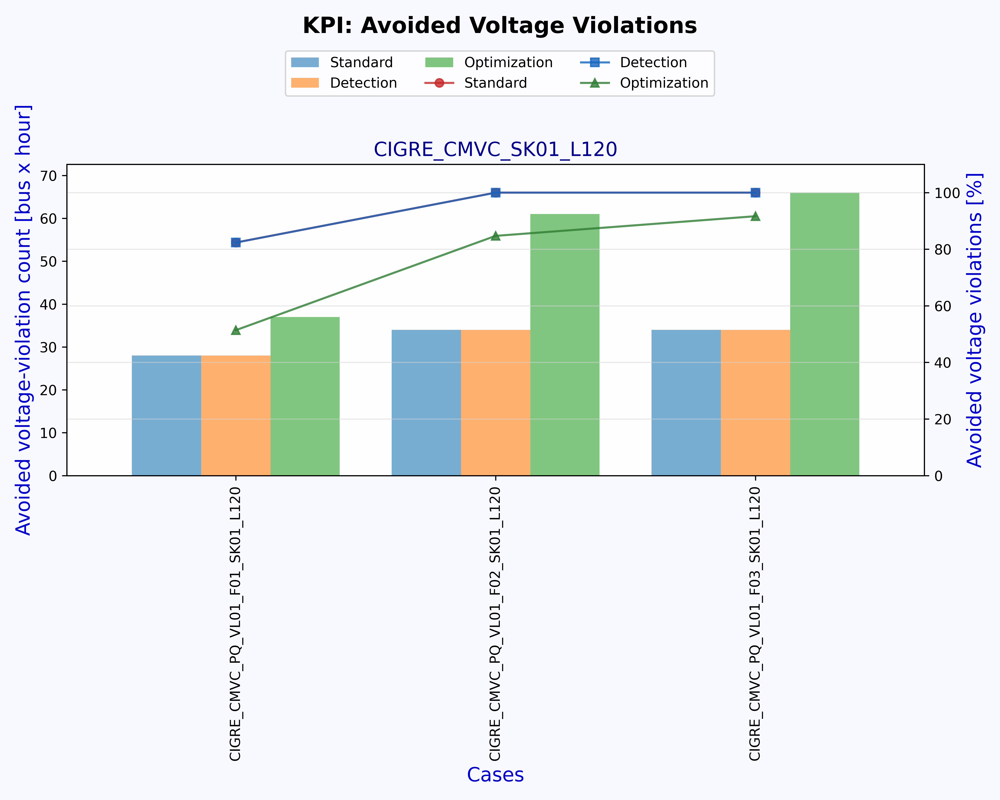
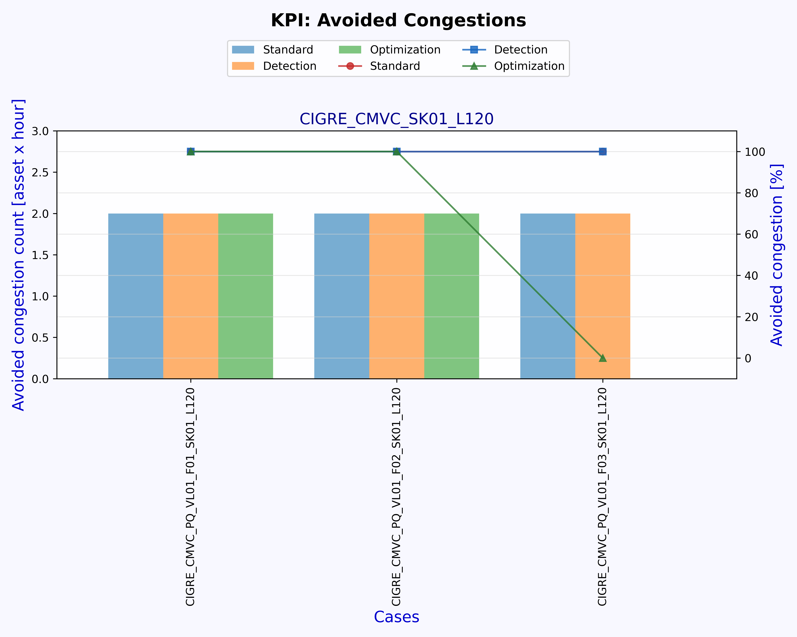
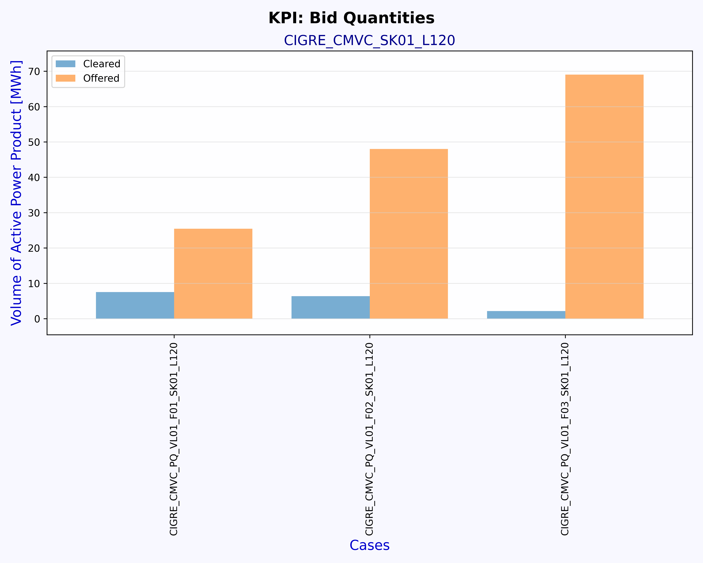
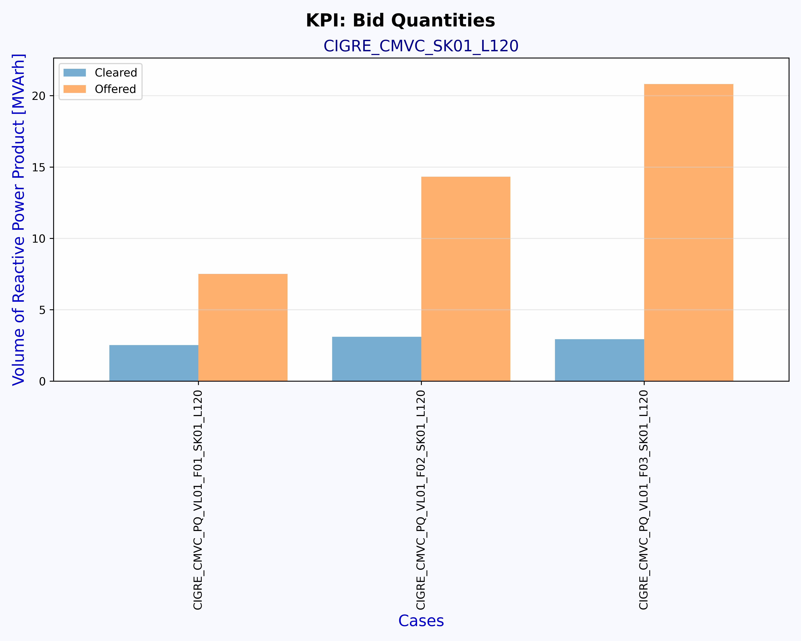
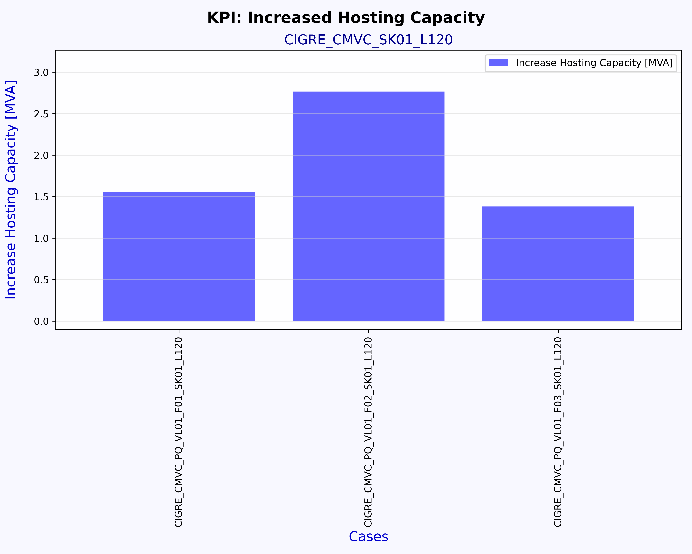

# Run the CIGRE example

This tutorial runs the smallest shipped example, the CIGRE medium-voltage benchmark, and reads its results. It takes about 4 minutes to run. At the end you know what a run writes, where to find the figures that matter and what the results of this example say about the market.

## Before you start

You need the platform installed and a Gurobi licence that solves models of this size. Both are covered in [Install enginIITe](installation.md).

Run the commands from the root of the repository. On Windows, keep the repository in a short path, and if it is long, add `--output C:\r`, or any other short folder, to the command below. Linux and macOS need neither. See [Common problems](../howto/common-problems.md).

## What the example contains

The example is a 20 kV network with two feeders and 15 buses, simulated for 24 hours with the loads scaled by 1.2. It has 33 flexibility service providers.

| Type | Resource | Providers | Price of active power | Price of reactive power |
|---|---|---|---|---|
| A | Flexible load | 18 | 45 EUR/MW | 2.25 EUR/MVAr |
| B | Distributed generator | 13 | 40 EUR/MW | 2.00 EUR/MVAr |
| C | Battery | 2 | 35 EUR/MW | 1.75 EUR/MVAr |

The configuration runs three scenarios, `F01`, `F02` and `F03`. They differ only in the capacity the providers offer. `F0k` multiplies the activation shares of the provider tables by `k`, so `F03` offers up to three times the flexibility of `F01`, because each offer is also capped by the rating of the provider. All three buy active and reactive power (`PQ`), apply the standard voltage band of 0.95 to 1.05 p.u. (`VL01`) and keep the batteries free of intertemporal limits.

## Run it

```bash
enginiite run examples/cigre/config/config_CIGRE.yaml
```

The command finds the workspace from the path of the configuration file, so it works from any folder. The console prints the workspace and the configuration first, then the progress of every stage for every scenario. The lines below are the ones to look for. The dots stand for the many lines in between.

```text
Workspace: <repository>\examples\cigre
Selected configuration: config_CIGRE.yaml
...
Solving the market with Gurobi (2702 constraints, 2970 variables); progress: ...\GReports\gurobi_..._split0.log
...
Time elapsed: 0.00 hours, 3.00 minutes, 10.63 seconds
...
  TOTAL RUN                          190.6 s
```

The run ends with a table of the slowest stages. If the command stops with an error instead, see [Common problems](../howto/common-problems.md).

## What a run writes

The results go to `examples/cigre/data_out/CIGRE_CMVC_SK01_L120/`. The name joins the network, the model, the storage tag and the simulation tag of the configuration.

```text
CIGRE_CMVC_SK01_L120/
├── CIGRE_CMVC_PQ_VL01_F01_SK01_L120/   one folder per scenario
├── CIGRE_CMVC_PQ_VL01_F02_SK01_L120/
├── CIGRE_CMVC_PQ_VL01_F03_SK01_L120/
├── comparison/                         the scenarios side by side
├── ConsistencyCheck/                   checks across scenarios
├── res_ts_net/                         power flow before any market
└── KPI_results_CIGRE_CMVC_SK01_L120/   the KPI workbook and its figures
```

Inside a scenario folder, the files to know first are the following.

| Path | Content |
|---|---|
| `model_results_<scenario>.xlsx` | Activations and prices chosen by the market |
| `VM_Problems_Stats_preMKT.xlsx` and `VM_Problems_Stats_postMKT.xlsx` | Buses by hours, with the voltage where it is outside the band |
| `FinalNetSettlement.csv` | Final activation, price and settlement cost of each provider in each hour |
| `GReports/` | The Gurobi log and the model files |
| `visualization/` | Interactive figures of the scenario |

The [output files reference](../reference/output-files.md) describes every file. This tutorial uses only the KPI workbook, `KPI_results_CIGRE_CMVC_SK01_L120/CIGRE_CMVC_SK01_L120.xlsx`, and the figures next to it.

## Read the cost table

Open the sheet `Overall_Results`. It has one row per scenario.

| Scenario | Objective (EUR) | Voltage penalty (EUR) | Active power cost (EUR) | Reactive power cost (EUR) | Active power cleared (MW) | Reactive power cleared (MVAr) |
|---|---|---|---|---|---|---|
| F01 | 79,403.66 | 79,062.60 | 335.63 | 5.43 | 7.527 | 2.524 |
| F02 | 1,580.16 | 1,290.15 | 283.54 | 6.48 | 6.375 | 3.102 |
| F03 | 99.33 | 0.00 | 93.49 | 5.84 | 2.155 | 2.930 |

The objective that the market minimises is the cost of the activations plus a penalty for what it cannot resolve. For `F01`, 79,062.60 plus 335.63 plus 5.43 gives the objective. The penalty on voltage is the voltage slack, converted to power, times the value of lost load of the configuration (`BetaCost`, 6,260 EUR/MWh). It is the largest term whenever some voltage violation remains. The congestion penalty is zero in the three scenarios.

The first conclusion is already in this table. With more flexibility offered, the cost falls from about 79,400 EUR to about 1,580 EUR and then to about 99 EUR, and the voltage penalty disappears in `F03`.

## Check the verification step

The cost table is the result of a sequence, not of a single market. After the main market, the platform applies the dispatch to the exact AC power flow and checks the result. A case is secure when every bus is between 0.95 and 1.05 p.u. and every line and transformer is loaded at 100 % or less. These are the detection limits of the configuration, which here equal the standard limits because `tol_v` and `tol_i` are zero. If it is not secure, a corrective market runs. It keeps the first clearing, calculates the sensitivities again at the operating point that the dispatch left, and clears again with the capacity that the providers have left. The configuration allows one corrective market (`max_corrective_market_running: 1`), and the cost of the sequence is settled as one market on the final position of each provider. The file `ACMarketValidation.csv` in each scenario folder records every verification. [Verification and the corrective market](../how-it-works/verification-and-corrective-market.md) explains the sequence in detail.

| Scenario | Corrective markets that ran | Lowest voltage (p.u.) | Highest loading (%) | Voltage violations |
|---|---|---|---|---|
| F01 | 1 | 0.9476 | 96.44 | 6 |
| F02 | 0 | 0.9573 | 90.98 | 0 |
| F03 | 0 | 0.9591 | 97.15 | 0 |

`F02` and `F03` pass the verification at the first attempt. `F01` does not, because six bus-hours stay below 0.95 p.u., so a corrective market runs once. It leaves the same six violations and the same lowest voltage, so it does not help. The figures below, and the cost table above, are the final results of these sequences.

## Read the figures

The KPI folder holds ten figures. The seven below are the ones that explain this example.

### Voltage violations



*Avoided voltage violations, in bus-hours. The bars are counts and the lines are percentages.*

Before the market, 34 bus-hours are below 0.95 p.u. and none is above 1.05 p.u., so the problem of this network is under-voltage. Each group of bars compares three bands, the standard band, the detection band and the optimisation band. In this example the standard and detection bands are the same, because the detection margin `tol_v` is zero. The optimisation band is tighter, from 0.9595 to 1.0395 p.u., because `tol_v_opt` is 1 %, and it has more violations before the market.

| Scenario | Avoided in the standard band | Avoided in the optimisation band |
|---|---|---|
| F01 | 28 of 34 (82 %) | 37 (51 %) |
| F02 | 34 of 34 (100 %) | 61 (85 %) |
| F03 | 34 of 34 (100 %) | 66 (92 %) |

The three percentages of the optimisation band come from the same total, 72 bus-hours below 0.9595 p.u. before the market. In `F01`, six bus-hours stay below 0.95 p.u. after the market, and that is what the voltage penalty of the cost table pays for. In `F02` and `F03` the standard band is fully restored. `F02` pays a small penalty, 1,290 EUR, because the market could not bring every bus inside the tighter band. `F03` pays none. In both, the exact power flow that verifies the result leaves some bus-hours just outside the tighter band, 11 in `F02` and 6 in `F03`, all of them inside the standard band.


*Voltage histogram. Left, the distribution of the voltage of all buses and hours. Right, the number of voltage violations.*

The left panel shows how the voltages move. The dashed light blue curve is the network before the market, and it reaches below the left dashed red line, which marks 0.95 p.u. The orange, green and red curves are `F01`, `F02` and `F03` after the market, and their lower end is lifted. The right panel counts the violations, 34 before the market and 6, 0 and 0 after it.

### Congestion



*Avoided congestions, in asset-hours.*

Two asset-hours are congested before the market, both of them transformers loaded above 100 %. The worst is the transformer with ID 0 at hour 19, loaded at 102.7 %. The standard and detection bands show all of them resolved in the three scenarios. The optimisation band is stricter, because the market aims at 97 % of the rating (`tol_i_opt` is 3 %). Under that target `F01` and `F02` resolve everything, and `F03` does not.

The reason is visible in the hosting capacity sheets. After the market in `F03`, the transformer is loaded at 97.15 %, which is below 100 % but above the target of 97 %. The market's own constraints are met, because its congestion slack is zero in the three scenarios, so the gap comes from the sensitivities being a linear approximation of the exact power flow that verifies the result. That is the linearisation error. The margin `tol_i_opt` exists to absorb it, and here the loading ends 0.15 percentage points above the target.


*Loading of the lines. The dashed red line marks 100 %.*

The line figures show nothing above 100 %, and the right panel is empty. That is correct. The most loaded line before the market is line 1, at 73.5 %, so the congestion of this example is only in the transformers.

### Activated volumes



*Active power, cleared and offered.*



*Reactive power, cleared and offered.*

The cleared volumes are those of the cost table, 7.5, 6.4 and 2.2 MWh of active power and 2.5, 3.1 and 2.9 MVArh of reactive power. The offered volumes grow with the scenario. They are 25.5, 48.0 and 69.1 MWh of active power, and 7.5, 14.3 and 20.8 MVArh of reactive power. One caution applies to these figures. The offered volume adds the headroom in both directions, while the cleared volume counts the direction that was used, so the comparison is indicative and not an exact utilisation rate.

With that in mind, the share of the offer that the market uses falls from about 30 % in `F01` to about 13 % in `F02` and 3 % in `F03`. The market buys only what it needs, and with more on offer it needs less of the expensive part.

The sheet `FlexALL` splits the activations by type of provider.

| Type | Active power F01 / F02 / F03 (MW) | Reactive power F01 / F02 / F03 (MVAr) |
|---|---|---|
| A, loads | 7.150 / 5.994 / 1.772 | 1.762 / 1.578 / 0.655 |
| B, generators | 0.137 / 0.092 / 0.068 | 0.522 / 1.043 / 1.555 |
| C, batteries | 0.240 / 0.289 / 0.314 | 0.240 / 0.480 / 0.720 |

Loads provide most of the active power, 95 %, 94 % and 82 % in the three scenarios. Their active power falls from 7.15 MW in `F01` to 1.77 MW in `F03`, while the reactive power of the generators and the batteries rises. The numbers are consistent with the prices. Active power from a load costs 45 EUR/MW, and reactive power from a battery or a generator costs 1.75 and 2 EUR/MVAr. The pattern fits a market that lifts the voltage with cheap reactive power instead of curtailing expensive load. The reactive power of the batteries is exactly 0.24, 0.48 and 0.72 MVAr, proportional to the scenario, which suggests that the batteries are used at the limit of what they offer in the three scenarios.

### Hosting capacity



*Increase of hosting capacity, in MVA.*

The hosting capacity is the headroom of the most loaded element, computed here from the loading of lines and transformers. It is negative when an element is overloaded. The increase is the headroom after the market minus the headroom before it.

| Scenario | Before (MVA) | After (MVA) | Increase (MVA) | Limiting element after the market |
|---|---|---|---|---|
| F01 | -0.668 | 0.890 | 1.558 | Transformer 0, at 96.4 % |
| F02 | -0.668 | 2.098 | 2.766 | Line 1, at 57.6 % |
| F03 | -0.668 | 0.713 | 1.381 | Transformer 0, at 97.1 % |

Before the market the transformer is overloaded by 0.668 MVA. The increase does not grow with the size of the offer. `F03` has the largest offer and the smallest increase of the three, because the market stops activating once its targets are met, and it leaves the transformer at 97 %. The hosting capacity measures the headroom that remains, not the effort made.

## What this example shows

- More offered flexibility lowers the cost and removes the violations. The voltage violations that remain fall from 6 to 0 and 0, and the objective from about 79,400 to 1,580 and 99 EUR.
- The congestion of the transformers is resolved in the three scenarios, but the stricter 97 % target is missed in `F03` by 0.15 percentage points, which is the linearisation error of the market.
- With little on offer, the market curtails load. With more on offer, it replaces part of that curtailment with cheaper reactive support.
- The hosting capacity reflects the headroom that remains after the market and does not grow with the size of the offer.

## Check your run against the reference

The folder `examples/cigre/expected/` holds the figures that a correct run reproduces, scenario by scenario. Compare your run with them from the root of the repository.

```bash
python -m unittest discover -s tests/regression
```

The test for CIGRE passes when your costs match the reference within 0.2 %. Small differences in variables that have several equivalent optimal values, such as the reactive power of a generator, do not affect the costs. If the results are not found, the test is skipped and says why.

## Next steps

- Replace the inputs of this example with your own in [Prepare your own study](build-your-study.md).
- Run twelve independent snapshots with a corrective market in [Run independent snapshots on the SB72 network](sb72-snapshots.md).
- Read what each output file contains in the [output files reference](../reference/output-files.md), and how to change the scenarios in the [configuration reference](../reference/configuration.md).
- Follow the four stages that a run goes through in [How it works](../how-it-works/four-stages.md), and the verification step in [Verification and the corrective market](../how-it-works/verification-and-corrective-market.md).
- Check your own inputs before a long run with the [input validator](../howto/check-your-inputs.md).
