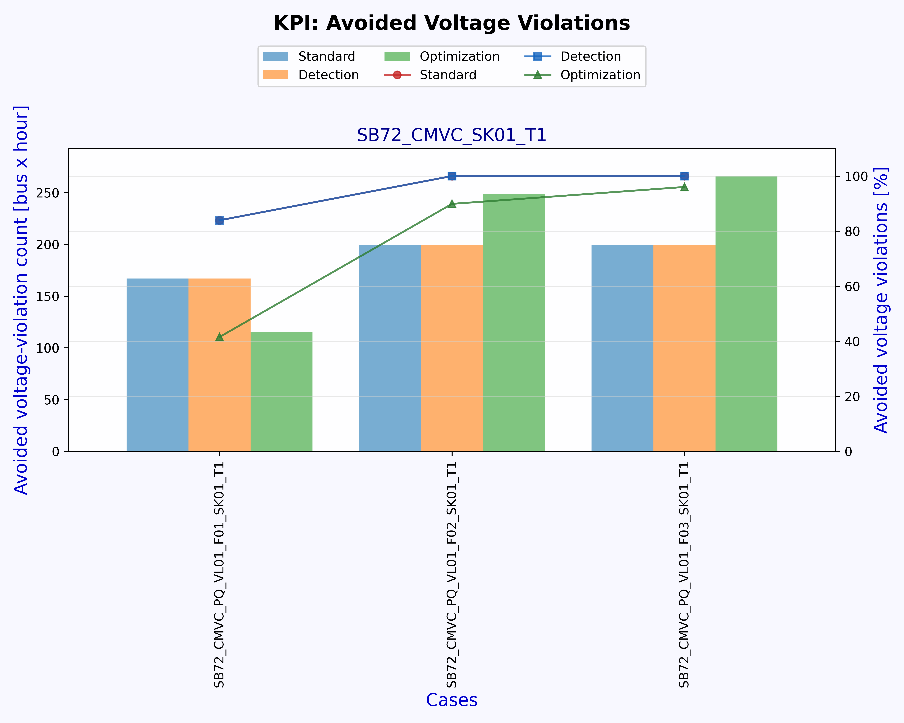
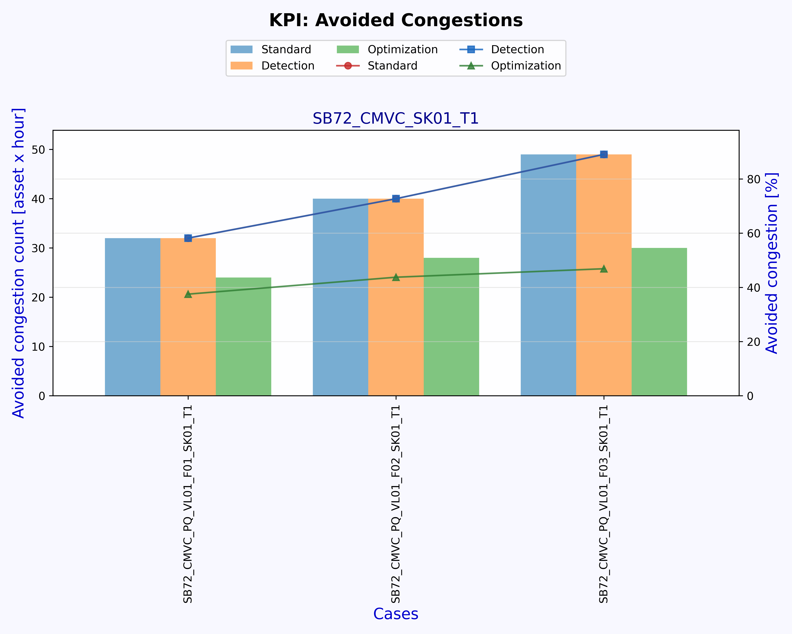
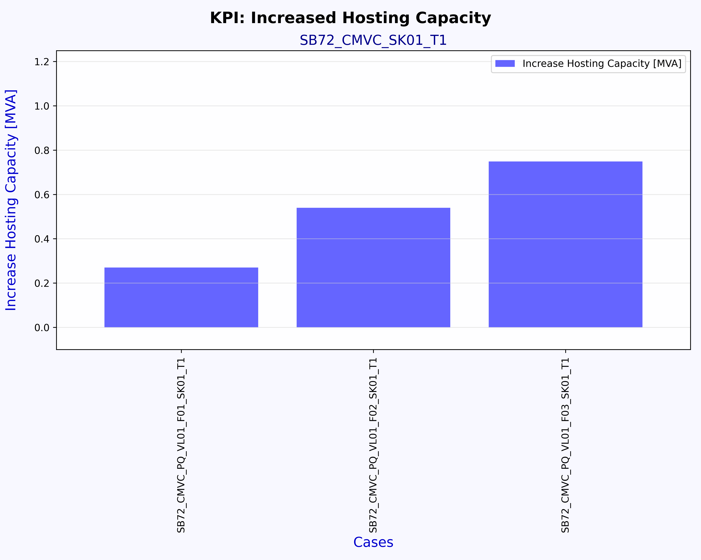

# Run independent snapshots on the SB72 network

This tutorial runs the SB72 example, a medium-voltage network with twelve operating snapshots. It shows how the platform treats independent snapshots, how its verification step and its corrective market work, and how to read results in which some problems remain. The run takes about 20 minutes.

## Before you start

Run the [CIGRE tutorial](first-run.md) first, which explains the cost table and the figures that this tutorial reuses. You need the platform installed and a Gurobi licence that solves models of this size.

On Windows, if the path of your repository is long, send the results to a short folder with `--output`, as in the command below. See [Common problems](../howto/common-problems.md).

## What the example contains

The network is a medium-voltage distribution network, with 110 kV transformers at its head, taken from the SimBench benchmark. The input notes of the example, `data_in/SB72/README_SB72_v3.md`, describe it in detail. The market has 153 providers.

| Providers | Loads (A) | Generators (B) | Batteries (C) |
|---|---|---|---|
| 153 | 74 | 73 | 6 |

### Twelve independent snapshots

The simulation window is `[0, 12]`, but the twelve entries are not consecutive hours. They are twelve operating snapshots, and each one is cleared as its own market (`simulation_window_as_timesteps: False`, `consecutive_hours: 1`). The figures and the KPI sheets still call them hours.

The names of the snapshots join a background, an extent and a severity. The background is `DER` for a sunny, windy weekend noon, `LOAD` for a winter evening peak and `MIX` for a sunny, windy weekday noon with business demand. The extent is `LOC` when the problem is localized in one feeder and `WID` when it is widespread. The severity is `LOW` or `HIGH`. The table shows the problems that each snapshot has before the market.

| Snapshot | Name | Buses over 1.05 / under 0.95 p.u. | Lines above 100 % |
|:---:|:---:|:---:|:---:|
| S1 | DER_LOC_LOW | 7 / 0 | 1 |
| S2 | DER_LOC_HIGH | 8 / 0 | 1 |
| S3 | DER_WID_LOW | 13 / 0 | 2 |
| S4 | DER_WID_HIGH | 15 / 0 | 3 |
| S5 | LOAD_LOC_LOW | 0 / 11 | 3 |
| S6 | LOAD_LOC_HIGH | 0 / 13 | 3 |
| S7 | LOAD_WID_LOW | 0 / 28 | 5 |
| S8 | LOAD_WID_HIGH | 0 / 30 | 6 |
| S9 | MIX_LOC_LOW | 5 / 9 | 4 |
| S10 | MIX_LOC_HIGH | 6 / 10 | 6 |
| S11 | MIX_WID_LOW | 4 / 16 | 10 |
| S12 | MIX_WID_HIGH | 5 / 19 | 11 |

Added up, the snapshots have 199 bus violations (63 over-voltage and 136 under-voltage) and 55 overloaded lines, and no transformer is overloaded. The KPI sheets report the same totals, which is a good check that you are reading the right run.

The configuration runs three scenarios, `F01`, `F02` and `F03`, with a growing offer. `F0k` multiplies by `k` the share of its power that each provider offers.

## Run it

Run it from the root of the repository. The option `--output` is for Windows, where it keeps the paths short.

```bash
enginiite run examples/sb72/config/config_SB72.yaml --output C:\r
```

On Linux and macOS, leave `--output` out and the results go to `examples/sb72/data_out/`. On a laptop, the run took about 20 minutes. The results are in `SB72_CMVC_SK01_T1/`, with the same layout as in the CIGRE tutorial.

## How a snapshot becomes secure

The configuration allows one corrective market (`max_corrective_market_running: 1`). The verification of the CIGRE tutorial works here snapshot by snapshot.

1. The main market clears every snapshot.
2. The platform applies each dispatch to the exact AC power flow. A snapshot is **secure** when every bus is between 0.95 and 1.05 p.u. and every line and transformer is loaded at 100 % or less. These are the detection limits of the configuration, which here equal the standard limits because `tol_v` and `tol_i` are zero.
3. The snapshots that are not secure are cleared again in a corrective market, which recalculates the sensitivities at the operating point that the dispatch left and uses the capacity that the providers have left. The secure snapshots keep their clearing.
4. The platform checks again, and nothing else runs, because only one corrective market is allowed.

The file `ACMarketValidationBySnapshot.csv` of each scenario has one row per snapshot and iteration, with the extremes of the power flow, the column `secure` and a `decision`. The decision `kept_earlier_clearing` means that the snapshot was secure after the main market and was not cleared again. The decision `stop_secure` means that the corrective market made it secure. The decision `stop_corrective_limit` means that it is still not secure and no corrective market is left.

To count the secure snapshots of a run, read those files. This snippet prints, for each scenario, the number of secure snapshots after the main market and at the end.

```python
import glob
import os

import pandas as pd

pattern = 'examples/sb72/data_out/SB72_CMVC_SK01_T1/*/ACMarketValidationBySnapshot.csv'
for path in sorted(glob.glob(pattern)):
    table = pd.read_csv(path)
    final = table.sort_values('iteration').groupby('snapshot').tail(1)
    first = table[table['iteration'] == 0]
    scenario = os.path.basename(os.path.dirname(path))
    print(scenario, int(first['secure'].sum()), '->', int(final['secure'].sum()), 'of', len(final))
```

## Read the results

### Costs

The objective that the market minimises is the cost of the activations plus the penalties for what it cannot resolve. The settlement cost is the cost of the activations alone, the active plus the reactive power cost of the sheet `Overall_Results`. The penalties are the rest.

| Scenario | Objective (EUR) | Settlement cost (EUR) | Penalties (EUR) |
|---|---|---|---|
| F01 | 1,195,361.48 | 1,127.25 | 1,194,234.22 |
| F02 | 133,102.41 | 1,571.18 | 131,531.23 |
| F03 | 31,535.16 | 1,426.91 | 30,108.24 |

Snapshots remain insecure in the three scenarios, so the penalties decide the objective. They are about a thousand times the settlement cost in `F01`, about eighty times in `F02` and about twenty times in `F03`. The objective falls as the offer grows, from 1.2 million to 31,500 EUR, because more snapshots are resolved. The settlement cost does not fall with it. It follows the power activated, 26.7 MW of active power in `F01`, 36.8 MW in `F02` and 32.3 MW in `F03`.

### Security

| Scenario | Secure after the main market | Secure at the end | Voltage violations left (of 199) | Overloaded lines left (of 55) |
|---|---|---|---|---|
| F01 | 3 of 12 | 3 of 12 | 32 | 23 |
| F02 | 5 of 12 | 6 of 12 | 0 | 15 |
| F03 | 9 of 12 | 10 of 12 | 0 | 6 |

The grid below shows which snapshots are secure. `S` marks a snapshot that is secure after the main market, `C` one that the corrective market made secure, and `-` one that is not secure at the end.

| Scenario | S1 | S2 | S3 | S4 | S5 | S6 | S7 | S8 | S9 | S10 | S11 | S12 |
|---|---|---|---|---|---|---|---|---|---|---|---|---|
| F01 | S | S | S | - | - | - | - | - | - | - | - | - |
| F02 | S | C | S | S | - | - | - | - | S | - | S | - |
| F03 | S | S | S | S | S | - | S | - | S | S | C | S |

Three things stand out in the tables.

- **More offer secures more snapshots.** The count grows from three of twelve in `F01` to ten of twelve in `F03`. The two snapshots that `F03` still cannot resolve are `LOAD_LOC_HIGH` and `LOAD_WID_HIGH`.
- **The hardest snapshots are the severe under-voltage ones.** `S6` and `S8` stay insecure even in `F03`.
- **The corrective market rescues few snapshots here.** It makes `S2` secure in `F02` and `S11` in `F03`, and none in `F01`. The exact power flow shows violations that the linearised market did not see, and the corrective market removes them only when the providers have capacity left.

### Who provides what

The activated power, added over the twelve snapshots, shows which providers carry the problem. The prices are the same as in the CIGRE example, 45 EUR/MW and 2.25 EUR/MVAr for loads, 40 and 2.00 for generators and 35 and 1.75 for batteries.

| Scenario | Active power A / B / C (MW) | Reactive power A / B / C (MVAr) |
|---|---|---|
| F01 | 4.81 / 9.01 / 12.84 | 1.27 / 37.24 / 13.70 |
| F02 | 7.14 / 9.86 / 19.76 | 1.95 / 60.17 / 22.25 |
| F03 | 8.11 / 4.75 / 19.39 | 2.30 / 68.64 / 28.99 |

In this network the reactive power of the generators does most of the voltage support, 68.6 of the 99.9 MVAr in `F03`, and the batteries provide most of the active power, 19.4 of the 32.3 MW. The numbers are consistent with the prices, because reactive power is cheap and the batteries have the lowest price for active power.

## Read the figures

The run writes the same ten figures as the CIGRE example. The vertical axes call the snapshots hours.



*Avoided voltage violations, in bus-snapshots.*

In the standard band, the market avoids 167 of the 199 violations in `F01`, which is 84 %, and all of them in `F02` and `F03`. The optimisation band is the tighter one, from 0.9595 to 1.0395 p.u. Before the market it has 277 violations, and the market avoids 115, 249 and 266 of them, which is 42 %, 90 % and 96 %. The 32 violations that remain in `F01` are what the voltage penalty of its cost pays for.



*Avoided congestions, in asset-snapshots.*

In the standard band, the market avoids 32 of the 55 overloads in `F01`, which is 58 %, 40 in `F02`, which is 73 %, and 49 in `F03`, which is 89 %. The optimisation target is stricter, 97 % of the rating, and before the market 64 asset-snapshots are above it. The market resolves 24, 28 and 30 of them, which is 38 %, 44 % and 47 %. The target of 97 % is the aim of the market, and it is not what decides whether a snapshot is secure, which is the limit of 100 %.



*Increase of hosting capacity, in MVA.*

The increase of hosting capacity, defined as in the CIGRE tutorial, is the following.

| F01 (MVA) | F02 (MVA) | F03 (MVA) |
|---|---|---|
| 0.270 | 0.540 | 0.749 |

Unlike in the CIGRE example, it grows with the offer in the three scenarios.

## What this example shows

- A deeper offer solves more snapshots. The count of secure snapshots grows from three to ten of twelve.
- The snapshots with severe under-voltage, `LOAD_LOC_HIGH` and `LOAD_WID_HIGH`, are the hardest to resolve.
- The verification with the exact power flow is essential. It reveals violations that the market did not see, and the corrective market removes them up to the capacity that the providers have left.
- When the problems are not resolved, the penalties dominate the objective. The cost of the activations is small, between 1,100 and 1,600 EUR for the twelve snapshots.
- The reactive power of the generators carries the voltage support, and the batteries carry most of the active power.

## Check your run against the reference

The file `examples/sb72/expected/sb72.json` has the figures that a correct run reproduces for each scenario. Compare your run with it from the root of the repository.

```bash
python -m unittest discover -s tests/regression
```

If you sent the results to a folder with `--output`, tell the test where they are with the environment variable `ENGINIITE_RESULTS_ROOT`. The test is skipped when the results are not found.

## Next steps

- Read how the platform verifies and corrects in [Verification and the corrective market](../how-it-works/verification-and-corrective-market.md), and what each output file contains in the [output files reference](../reference/output-files.md).
- Change the number of corrective markets, the voltage band or the tolerances in the [configuration reference](../reference/configuration.md).
- Check your own inputs before a long run with the [input validator](../howto/check-your-inputs.md).
